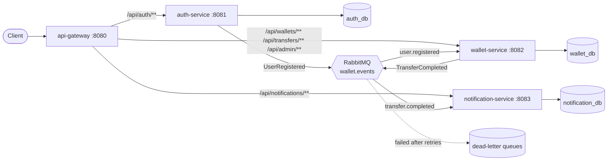
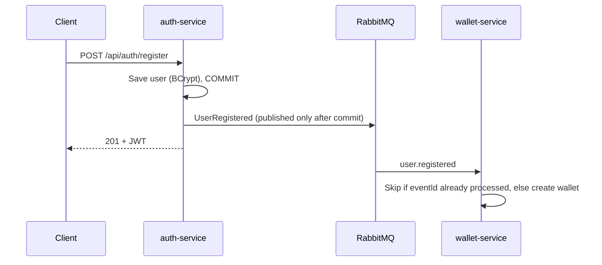

# Smart Wallet — Digital Wallet & Payments Microservices

A digital wallet backend built as **Spring Boot microservices** (Java 21), focused on the hard parts of payment systems: **double-entry ledgering, idempotent transfers, concurrency safety, and event-driven communication over RabbitMQ**.

> 🚧 **Status: In active development.** See the feature table and roadmap below.

---

## 🏗️ Architecture



| Service | Responsibility | Database |
|---|---|---|
| **api-gateway** | Single entry point; routes requests to services (Spring Cloud Gateway) | — |
| **auth-service** | Register, login, JWT issuing, roles (USER / ADMIN) | `auth_db` |
| **wallet-service** | Wallets, top-ups, transfers, double-entry ledger, idempotency, locking, admin freeze | `wallet_db` |
| **notification-service** | Consumes transfer events, stores notifications idempotently | `notification_db` |
| **common** (library) | Shared event contracts, JWT verification, error format, RabbitMQ JSON config | — |

### Registration flow (event-driven, no service-to-service HTTP)



### Transfer flow (one ACID transaction inside wallet-service)

```mermaid
sequenceDiagram
    participant C as Client
    participant W as wallet-service
    participant DB as wallet_db
    participant MQ as RabbitMQ

    C->>W: POST /api/transfers (Idempotency-Key)
    W->>DB: Key already completed?
    alt Same key, same request
        DB-->>W: stored response
        W-->>C: 201 original response (Idempotent-Replayed: true), no money moved
    else New key
        W->>DB: BEGIN; INSERT idempotency key (unique index blocks concurrent duplicates)
        W->>DB: SELECT ... FOR UPDATE both wallets, lower id first
        W->>DB: check rules: limit, self-transfer, frozen, sufficient funds
        W->>DB: DEBIT sender + CREDIT recipient (ledger pair), store response; COMMIT
        W->>MQ: TransferCompleted (after commit)
        W-->>C: 201 Created
    end
```

---

## 🧠 Key Design Decisions

- **Split by responsibility, not by wallet.** All wallets live in wallet-service, so a transfer is **one ACID transaction**. Splitting wallets across services would require a saga with compensating transactions — more complexity and more ways to lose money.
- **Database per service.** Each service owns its schema (Liquibase) and no service reads another's tables.
- **Events after commit.** Events are sent via `@TransactionalEventListener(AFTER_COMMIT)`, so consumers never act on data that was rolled back. *Trade-off:* if the broker is down at that moment the event is lost — the production fix is a **transactional outbox** (roadmap).
- **Idempotent consumers.** RabbitMQ delivers at-least-once; each consumer records handled `eventId`s and ignores duplicates.
- **Retries + dead-letter queues.** A failing message is retried 3 times with backoff, then parked in a DLQ instead of blocking the queue forever.
- **Stateless JWT.** auth-service signs tokens; every service verifies them with the shared secret, so there is no auth round-trip per request, and a request that bypasses the gateway is still rejected.
- **Double-entry ledger with a SYSTEM wallet.** Top-ups move money *from* a SYSTEM funding wallet, so every movement is a balanced DEBIT + CREDIT pair and **the sum of all balances is always zero**.
- **Pessimistic locking in id order.** Wallet rows are locked with `SELECT ... FOR UPDATE` in ascending id order, which prevents lost updates *and* deadlocks.
- **Idempotency keys backed by a unique index.** A retry with the same key returns the stored response; a *concurrent* duplicate blocks on the unique index and fails once the first commits, so two identical requests can never both move money. Reusing a key for a different request is rejected (409).
- **Shared messaging topology.** Every service declares all exchanges, queues and DLQs on connect. Without this, an event published before its consumer had ever started had no queue and was silently dropped (found and fixed during development).
- **Freeze takes the same row lock as transfers.** A freeze waits for any in-flight transfer on that wallet, and every later transfer sees it frozen, so there is no window where money moves out of a frozen wallet.
- **Defense in depth.** The database itself rejects negative user balances (`CHECK` constraint), even if application code has a bug.

---

## ✨ Features

| # | Feature | Status |
|---|---------|--------|
| 1 | JWT authentication with `USER` / `ADMIN` roles, admin bootstrap | ✅ Done |
| 2 | Wallet auto-created from `UserRegistered` event, balance check, simulated top-up | ✅ Done |
| 3 | Append-only **double-entry ledger** (DEBIT + CREDIT in one DB transaction) | ✅ Done |
| 4 | **Idempotent transfers** via `Idempotency-Key` header, incl. concurrent duplicates | ✅ Done |
| 5 | **Concurrency safety** — pessimistic locking in id order, verified with 100 parallel transfers | ✅ Done |
| 6 | Transfer rules — insufficient funds, limit, self-transfer & frozen-wallet blocking | ✅ Done |
| 7 | Paginated transaction history with date filters | ✅ Done |
| 8 | `TransferCompleted` events, idempotent notification consumer, DLQ | ✅ Done |
| 9 | Admin APIs to list, freeze / unfreeze wallets (SYSTEM wallet protected) | ✅ Done |
| 10 | Liquibase, OpenAPI per service, tests, Docker Compose, live deployment | 🚧 Ongoing |

---

## 🛠️ Tech Stack

Java 21 · Spring Boot 3.3 · Spring Cloud Gateway · Spring Security (JWT) · Spring Data JPA · PostgreSQL 16 · Liquibase · RabbitMQ · springdoc-openapi · JUnit 5 · Mockito · Docker Compose

---

## 📡 API (through the gateway on `:8080`)

| Method | Endpoint | Description | Role |
|--------|----------|-------------|------|
| POST | `/api/auth/register` | Register (wallet created asynchronously) | Public |
| POST | `/api/auth/login` | Login, returns JWT | Public |
| GET | `/api/auth/me` | Identity from token | USER |
| GET | `/api/wallets/me` | My wallet & balance | USER |
| POST | `/api/wallets/me/top-up` | Simulated top-up | USER |
| POST | `/api/transfers` | P2P transfer by recipient email (`Idempotency-Key` required) | USER |
| GET | `/api/wallets/me/transactions?from=&to=&page=&size=` | Paginated history (dates inclusive, UTC) | USER |
| GET | `/api/notifications` · `/unread-count` | My notifications, newest first | USER |
| POST | `/api/notifications/{id}/read` | Mark as read | USER |
| GET | `/api/admin/wallets` · `/{id}` | List / inspect wallets | ADMIN |
| POST | `/api/admin/wallets/{id}/freeze` · `/unfreeze` | Freeze / unfreeze | ADMIN |

Swagger UI per service: `http://localhost:8081/swagger-ui.html`, `:8082`, `:8083`.

---

## 🚀 Getting Started

**Prerequisites:** Java 21, Maven 3.9+, Docker

```bash
# Everything in Docker (Postgres creates auth_db, wallet_db, notification_db on first start)
docker compose up --build
```

Or run services from your IDE/terminal against Dockerized infrastructure:

```bash
docker compose up -d postgres rabbitmq
mvn -q install -DskipTests                 # builds the shared common library first
mvn -pl auth-service spring-boot:run       # one terminal per service
mvn -pl wallet-service spring-boot:run
mvn -pl notification-service spring-boot:run
mvn -pl api-gateway spring-boot:run
```

Run all tests: `mvn test` (Docker must be running: integration tests start a real PostgreSQL with Testcontainers)

### Tested guarantees (`TransferServiceIntegrationTest`, real PostgreSQL)

| Scenario | Result |
|---|---|
| 100 transfers in both directions between the same two wallets, all at once | No deadlock, no lost update, balances exact |
| 20 parallel ₹10 transfers from a ₹100 balance | Exactly 10 succeed, 10 rejected, balance never negative |
| Same `Idempotency-Key` sent twice | Money moves once; retry gets the original response |
| Same key sent 10 times concurrently | Exactly one debit |
| Same key, different amount | Rejected with 409 |
| Sum of all wallet balances after every test | Always exactly 0 |
| HTTP: no token / bad token / USER on admin API | 401 / 401 / 403 (`WalletApiIntegrationTest`) |
| Frozen wallet tries to send; admin unfreezes | 422 `WALLET_FROZEN`, then transfer succeeds |

Default admin (local only): `admin@smartwallet.dev` / `Admin@12345` · RabbitMQ UI: `http://localhost:15672` (guest / guest)

---

## 🗺️ Roadmap

- [x] Day 1 — Microservice structure, shared library, JWT auth, event-driven wallet creation, top-ups with double-entry ledger
- [x] Day 2 — Transfers with idempotency keys, transfer rules, concurrency tests (100 parallel transfers), messaging race fix
- [x] Day 3 — TransferCompleted events → notifications, DLQ, admin freeze, history API
- [ ] Live deployment
- [ ] Later — transactional outbox, rate limiting at the gateway

---

## 👤 Author

**Vardhankumar Mekala** — Backend Software Engineer
[LinkedIn](https://www.linkedin.com/in/vardhankumar-mekala-43459339b/)
