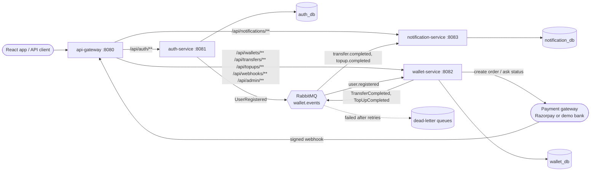
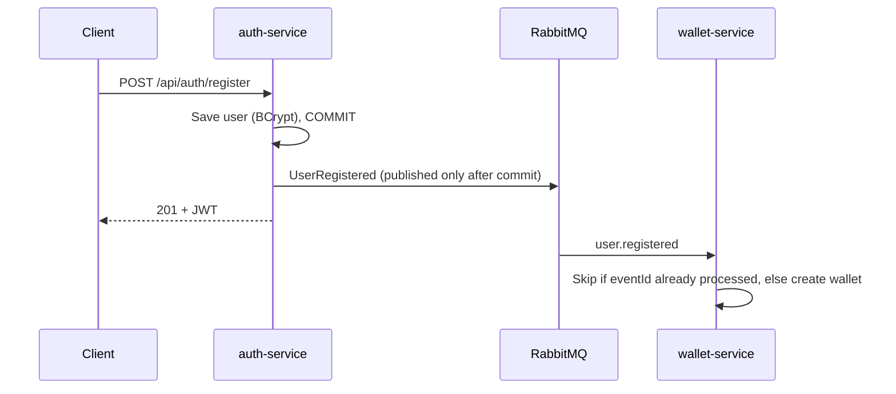
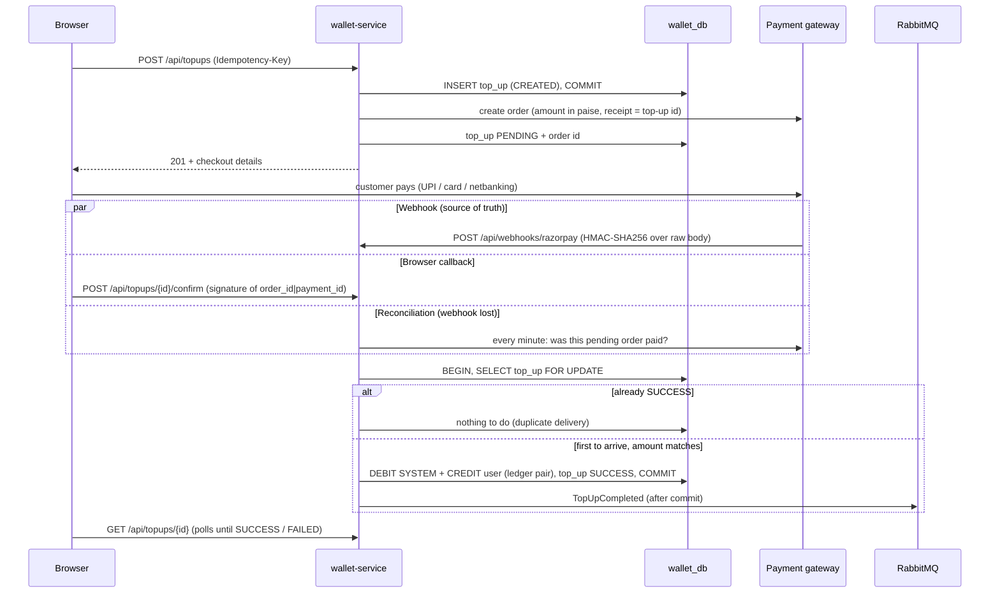
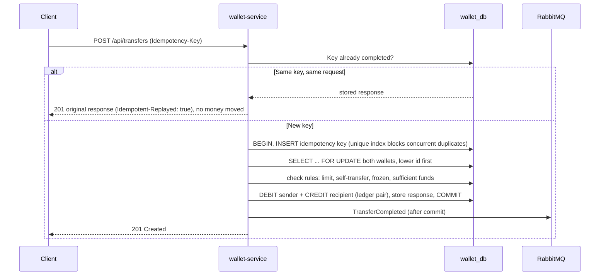

# Smart Wallet — Digital Wallet & Payments Microservices

A digital wallet built as **Spring Boot microservices** (Java 21) with a small **React** frontend, focused on the hard parts of payment systems: **double-entry ledgering, idempotent transfers, payment-gateway top-ups that credit exactly once, concurrency safety, and event-driven communication over RabbitMQ**.

## 🌐 Live demo

| | URL |
|---|---|
| API gateway (single entry point) | https://smartwallet-gateway-a2lr.onrender.com |
| Swagger — auth-service | https://smartwallet-auth-a2lr.onrender.com/swagger-ui.html |
| Swagger — wallet-service | https://smartwallet-wallet-a2lr.onrender.com/swagger-ui.html |
| Swagger — notification-service | https://smartwallet-notification-a2lr.onrender.com/swagger-ui.html |

Hosted on free tiers (Render · Neon PostgreSQL · CloudAMQP): services sleep when idle, so **the first request can take about a minute** while they wake. Try it: register in the auth Swagger, copy the `accessToken`, click **Authorize** in the wallet Swagger, then top up and transfer. Details in [DEPLOYMENT.md](DEPLOYMENT.md).

---

## 🏗️ Architecture



| Service | Responsibility | Database |
|---|---|---|
| **api-gateway** | Single entry point; routes requests to services (Spring Cloud Gateway) | — |
| **auth-service** | Register, login, JWT issuing, roles (USER / ADMIN) | `auth_db` |
| **wallet-service** | Wallets, payment-gateway top-ups, transfers, double-entry ledger, idempotency, locking, admin freeze | `wallet_db` |
| **notification-service** | Consumes transfer and top-up events, stores notifications idempotently | `notification_db` |
| **frontend** | React + Vite single-page app: sign in, balance, add money, send money, passbook | — |
| **common** (library) | Shared event contracts, JWT verification, error format, RabbitMQ JSON config | — |

### Registration flow (event-driven, no service-to-service HTTP)



### Top-up flow (money comes in through a payment gateway)

The browser never decides that a payment succeeded. The wallet is credited only when the gateway itself says so, and
three independent paths can deliver that news: the **signed webhook**, the **signed browser callback**, and a
**reconciliation job** that asks the gateway directly. All three end in the same method, which credits exactly once.



By default the gateway is a built-in **demo bank** (`PAYMENT_PROVIDER=mock`), so the project runs with no account and no
keys. It sends the same signed webhook format through the same code path as Razorpay, and can be told to decline a
payment or to "lose" the webhook so the reconciliation path can be seen working. Set `PAYMENT_PROVIDER=razorpay` with
test keys to use Razorpay's real checkout (UPI, cards, netbanking) in test mode.

### Transfer flow (one ACID transaction inside wallet-service)



---

## 🧠 Key Design Decisions

- **Split by responsibility, not by wallet.** All wallets live in wallet-service, so a transfer is **one ACID transaction**. Splitting wallets across services would require a saga with compensating transactions — more complexity and more ways to lose money.
- **Database per service.** Each service owns its schema (Liquibase) and no service reads another's tables.
- **Events after commit.** Events are sent via `@TransactionalEventListener(AFTER_COMMIT)`, so consumers never act on data that was rolled back. *Trade-off:* if the broker is down at that moment the event is lost — the production fix is a **transactional outbox** (roadmap).
- **Idempotent consumers.** RabbitMQ delivers at-least-once; each consumer records handled `eventId`s and ignores duplicates.
- **Retries + dead-letter queues.** A failing message is retried 3 times with backoff, then parked in a DLQ instead of blocking the queue forever.
- **Stateless JWT.** auth-service signs tokens; every service verifies them with the shared secret, so there is no auth round-trip per request, and a request that bypasses the gateway is still rejected.
- **Double-entry ledger with a SYSTEM wallet.** Top-ups move money *from* a SYSTEM funding wallet, so every movement is a balanced DEBIT + CREDIT pair and **the sum of all balances is always zero**.
- **Pessimistic locking in id order.** Wallet rows are locked with `SELECT ... FOR UPDATE` in ascending id order, which prevents lost updates *and* deadlocks.
- **Idempotency keys backed by a unique index.** A retry with the same key returns the stored response; a *concurrent* duplicate blocks on the unique index and fails once the first commits, so two identical requests can never both move money. Reusing a key for a different request is rejected (409).
- **Shared messaging topology.** Every service declares all exchanges, queues and DLQs on connect. Without this, an event published before its consumer had ever started had no queue and was silently dropped (found and fixed during development).
- **Freeze takes the same row lock as transfers.** A freeze waits for any in-flight transfer on that wallet, and every later transfer sees it frozen, so there is no window where money moves out of a frozen wallet.
- **Defense in depth.** The database itself rejects negative user balances (`CHECK` constraint), even if application code has a bug.
- **Top-ups trust the gateway, never the browser.** A top-up is credited only on a message whose HMAC-SHA256 signature verifies (compared in constant time), or on the gateway's own answer when asked. A webhook signature is checked against the **raw request bytes**, before any JSON parsing.
- **Exactly-once credit under at-least-once delivery.** Gateways retry webhooks, and the webhook, the browser callback and the reconciliation job can all arrive together. Each one locks the `top_ups` row (`FOR UPDATE`) and credits only if it is not already `SUCCESS`; a unique index on the gateway's payment id and a `CHECK` that ties `SUCCESS` to a ledger transaction back this up in the database.
- **No database transaction held open across an HTTP call.** Creating a top-up commits the row first, then calls the gateway, then stores the order id. A crash in between leaves a `CREATED` row that the reconciliation job expires, never a locked wallet.
- **A late success still wins.** `FAILED` and `EXPIRED` are not final: if the gateway later reports the payment as captured, the customer was charged, so the wallet is credited. Only `SUCCESS` is final. A paid amount that differs from the order is never credited.
- **Payment gateway behind an interface.** `PaymentGateway` has two implementations (Razorpay over plain REST, and the demo bank), chosen by one property, so the settlement logic is tested end to end without network access or secrets.

---

## ✨ Features

| # | Feature | Status |
|---|---------|--------|
| 1 | JWT authentication with `USER` / `ADMIN` roles, admin bootstrap | ✅ Done |
| 2 | Wallet auto-created from `UserRegistered` event, balance check | ✅ Done |
| 3 | Append-only **double-entry ledger** (DEBIT + CREDIT in one DB transaction) | ✅ Done |
| 4 | **Idempotent transfers** via `Idempotency-Key` header, incl. concurrent duplicates | ✅ Done |
| 5 | **Concurrency safety** — pessimistic locking in id order, verified with 100 parallel transfers | ✅ Done |
| 6 | Transfer rules — insufficient funds, limit, self-transfer & frozen-wallet blocking | ✅ Done |
| 7 | Paginated transaction history with date filters | ✅ Done |
| 8 | `TransferCompleted` events, idempotent notification consumer, DLQ | ✅ Done |
| 9 | Admin APIs to list, freeze / unfreeze wallets (SYSTEM wallet protected) | ✅ Done |
| 10 | **Payment-gateway top-ups** (Razorpay test mode or built-in demo bank): signed webhooks, browser confirm, reconciliation job, exactly-once credit | ✅ Done |
| 11 | `TopUpCompleted` events → "money added" notifications | ✅ Done |
| 12 | **React frontend**: demo account, balance, add money, send money, passbook, alerts | ✅ Done |
| 13 | Liquibase, OpenAPI per service, 55 automated tests, Docker Compose, live cloud deployment | ✅ Done |

---

## 🛠️ Tech Stack

Java 21 · Spring Boot 3.3 · Spring Cloud Gateway · Spring Security (JWT) · Spring Data JPA · PostgreSQL 16 · Liquibase · RabbitMQ · Razorpay Orders API · springdoc-openapi · JUnit 5 · Mockito · Testcontainers · Docker Compose · React 19 · Vite

---

## 📡 API (through the gateway on `:8080`)

| Method | Endpoint | Description | Role |
|--------|----------|-------------|------|
| POST | `/api/auth/register` | Register (wallet created asynchronously) | Public |
| POST | `/api/auth/login` | Login, returns JWT | Public |
| GET | `/api/auth/me` | Identity from token | USER |
| GET | `/api/wallets/me` | My wallet & balance | USER |
| POST | `/api/topups` | Start a top-up: creates a payment order (`Idempotency-Key` required) | USER |
| GET | `/api/topups/{id}` | Top-up status (`PENDING` → `SUCCESS` / `FAILED` / `EXPIRED`) | USER |
| POST | `/api/topups/{id}/confirm` | Browser callback after checkout (payment id + signature) | USER |
| POST | `/api/topups/{id}/sync` | Ask the gateway now instead of waiting for the webhook | USER |
| POST | `/api/webhooks/razorpay` | Payment gateway webhook (authenticated by `X-Razorpay-Signature`, no JWT) | Gateway |
| POST | `/api/topups/{id}/mock-pay` | Demo bank only: approve, decline, or approve and lose the webhook | USER |
| POST | `/api/wallets/me/top-up` | Instant credit with no payment, kept for API testing | USER |
| POST | `/api/transfers` | P2P transfer by recipient email (`Idempotency-Key` required) | USER |
| GET | `/api/wallets/me/transactions?from=&to=&page=&size=` | Paginated history (dates inclusive, UTC) | USER |
| GET | `/api/notifications` · `/unread-count` | My notifications, newest first | USER |
| POST | `/api/notifications/{id}/read` | Mark as read | USER |
| GET | `/api/admin/wallets` · `/{id}` | List / inspect wallets | ADMIN |
| POST | `/api/admin/wallets/{id}/freeze` · `/unfreeze` | Freeze / unfreeze | ADMIN |

Swagger UI per service: `http://localhost:8081/swagger-ui.html`, `:8082`, `:8083`.

---

## 🚀 Getting Started

**Prerequisites:** Java 21, Maven 3.9+, Docker

```bash
# Everything in Docker (Postgres creates auth_db, wallet_db, notification_db on first start)
docker compose up --build
```

Or run services from your IDE/terminal against Dockerized infrastructure:

```bash
docker compose up -d postgres rabbitmq
mvn -q install -DskipTests                 # builds the shared common library first
mvn -pl auth-service spring-boot:run       # one terminal per service
mvn -pl wallet-service spring-boot:run
mvn -pl notification-service spring-boot:run
mvn -pl api-gateway spring-boot:run
```

Then start the frontend (Node 20+):

```bash
cd frontend
npm install
npm run dev          # http://localhost:5173, calls the gateway on :8080
```

Choose **Open a demo account**, then **Add money**. With the default demo bank you approve or decline the payment on the
next screen. To use Razorpay's test checkout instead, create test keys in the Razorpay dashboard and start
wallet-service with:

```bash
PAYMENT_PROVIDER=razorpay RAZORPAY_KEY_ID=rzp_test_xxx RAZORPAY_KEY_SECRET=xxx RAZORPAY_WEBHOOK_SECRET=xxx \
  mvn -pl wallet-service spring-boot:run
```

On localhost Razorpay cannot reach your webhook URL; the browser callback and the reconciliation job complete the
top-up instead, which is exactly the case they exist for.

Run all tests: `mvn test` (Docker must be running: integration tests start a real PostgreSQL with Testcontainers)

### Tested guarantees (`TransferServiceIntegrationTest`, real PostgreSQL)

| Scenario | Result |
|---|---|
| 100 transfers in both directions between the same two wallets, all at once | No deadlock, no lost update, balances exact |
| 20 parallel ₹10 transfers from a ₹100 balance | Exactly 10 succeed, 10 rejected, balance never negative |
| Same `Idempotency-Key` sent twice | Money moves once; retry gets the original response |
| Same key sent 10 times concurrently | Exactly one debit |
| Same key, different amount | Rejected with 409 |
| Sum of all wallet balances after every test | Always exactly 0 |
| HTTP: no token / bad token / USER on admin API | 401 / 401 / 403 (`WalletApiIntegrationTest`) |
| Frozen wallet tries to send; admin unfreezes | 422 `WALLET_FROZEN`, then transfer succeeds |

### Tested guarantees for top-ups (`TopUpIntegrationTest`, real PostgreSQL)

| Scenario | Result |
|---|---|
| The same webhook delivered 10 times at once | Wallet credited exactly once |
| Webhook, browser confirm and reconciliation all report the same payment | One credit, one ledger pair |
| Webhook or browser callback with a wrong signature | 401, nothing credited |
| Paid amount differs from the order amount | Not credited |
| Same `Idempotency-Key` sent twice when starting a top-up | One order, same top-up returned |
| Payment fails, then the same order is paid | Credited (a late success wins) |
| Webhook never arrives | Reconciliation job finds the payment and credits it |
| Customer never pays | Top-up expires, nothing credited |
| Wallet is frozen after the customer has paid | Still credited: the customer was charged |
| Sum of all wallet balances after every test | Always exactly 0 |

Default admin (local only): `admin@smartwallet.dev` / `Admin@12345` · RabbitMQ UI: `http://localhost:15672` (guest / guest)

---

## 🗺️ Roadmap

- [x] Day 1 — Microservice structure, shared library, JWT auth, event-driven wallet creation, top-ups with double-entry ledger
- [x] Day 2 — Transfers with idempotency keys, transfer rules, concurrency tests (100 parallel transfers), messaging race fix
- [x] Day 3 — TransferCompleted events → notifications, DLQ, admin freeze, history API
- [x] Day 4 — Live deployment (Render Blueprint, Neon, CloudAMQP)
- [x] Day 5 — Payment-gateway top-ups (webhook + confirm + reconciliation, exactly-once credit), React frontend
- [ ] Later — transactional outbox, rate limiting at the gateway, refunds, withdrawals to a bank account

---

## 👤 Author

**Vardhankumar Mekala** — Backend Software Engineer
[LinkedIn](https://www.linkedin.com/in/vardhankumar-mekala-43459339b/)
