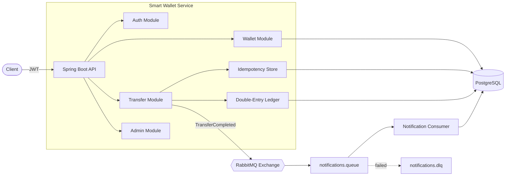

# Smart Wallet — Digital Wallet & Payments Backend

A multi-user digital wallet backend built with **Java 21** and **Spring Boot 3**, focused on the hard parts of payment systems: **double-entry ledgering, idempotent transfers, concurrency safety, and reliable async messaging**.

> 🚧 **Status: In active development.** See the feature table and roadmap below.

---

## ✨ Features

| # | Feature | Status |
|---|---------|--------|
| 1 | JWT authentication with `USER` / `ADMIN` roles | 🚧 In progress |
| 2 | One wallet per user, simulated top-up, balance check | 🚧 In progress |
| 3 | Append-only **double-entry ledger** (DEBIT + CREDIT in one DB transaction) | 🚧 In progress |
| 4 | **Idempotent transfers** via `Idempotency-Key` header | 🚧 In progress |
| 5 | **Concurrency safety** — pessimistic locking with ordered lock acquisition | 🚧 In progress |
| 6 | Transfer rules — insufficient funds, per-transfer limit, self-transfer & frozen-wallet blocking | 🚧 In progress |
| 7 | Paginated transaction history with date filters | 🚧 In progress |
| 8 | `TransferCompleted` events over **RabbitMQ**, idempotent consumer, dead-letter queue | 🚧 In progress |
| 9 | Admin APIs to freeze / unfreeze wallets | 🚧 In progress |
| 10 | Liquibase migrations, OpenAPI docs, JUnit + integration tests, Docker Compose | 🚧 In progress |

---

## 🏗️ Architecture



### Transfer flow

```mermaid
sequenceDiagram
    participant C as Client
    participant T as TransferService
    participant DB as PostgreSQL
    participant MQ as RabbitMQ

    C->>T: POST /api/transfers (Idempotency-Key)
    T->>DB: Lookup idempotency key
    alt Key already used
        DB-->>T: Stored response
        T-->>C: Return original response (no double charge)
    else New key
        T->>DB: BEGIN; SELECT ... FOR UPDATE (wallets locked in id order)
        T->>DB: Validate rules (funds, limit, frozen, self-transfer)
        T->>DB: Insert DEBIT + CREDIT ledger entries, update balances
        T->>DB: Save idempotency key + response; COMMIT
        T->>MQ: Publish TransferCompleted (after commit)
        T-->>C: 201 Created
    end
```

---

## 🧠 Key Design Decisions

- **Double-entry ledger** — every transfer produces exactly one DEBIT and one CREDIT entry. Ledger rows are append-only (never updated or deleted), giving a complete audit trail.
- **Idempotency keys** — clients send an `Idempotency-Key` header; retries with the same key return the original response instead of moving money twice.
- **Pessimistic locking with ordered acquisition** — both wallets are locked with `SELECT ... FOR UPDATE`, always in ascending wallet-id order, preventing lost updates and deadlocks.
- **Single ACID transaction instead of a saga** — both wallets live in one database, so one transaction guarantees atomicity. A saga/compensation pattern would only be needed if wallets were split across services.
- **Events published after commit** — notifications never fire for transfers that rolled back; consumers are idempotent so at-least-once delivery is safe.

---

## 🛠️ Tech Stack

Java 21 · Spring Boot 3 · Spring Security (JWT) · Spring Data JPA · PostgreSQL · Liquibase · RabbitMQ · springdoc-openapi · JUnit 5 · Testcontainers · Docker Compose

---

## 📡 API Endpoints (planned)

| Method | Endpoint | Description | Role |
|--------|----------|-------------|------|
| POST | `/api/auth/register` | Register a new user (wallet auto-created) | Public |
| POST | `/api/auth/login` | Login, returns JWT | Public |
| GET | `/api/wallets/me` | Get my wallet & balance | USER |
| POST | `/api/wallets/me/top-up` | Simulated top-up | USER |
| POST | `/api/transfers` | P2P transfer (`Idempotency-Key` header required) | USER |
| GET | `/api/transfers/history?from=&to=&page=&size=` | Paginated transaction history | USER |
| GET | `/api/notifications` | My notifications | USER |
| POST | `/api/admin/wallets/{id}/freeze` | Freeze a wallet | ADMIN |
| POST | `/api/admin/wallets/{id}/unfreeze` | Unfreeze a wallet | ADMIN |

Swagger UI (once running): `http://localhost:8080/swagger-ui.html`

---

## 🚀 Getting Started

**Prerequisites:** Java 21, Maven, Docker

```bash
# Start PostgreSQL + RabbitMQ
docker compose up -d postgres rabbitmq

# Run the app
mvn spring-boot:run

# Or run everything in Docker
docker compose up --build
```

RabbitMQ management UI: `http://localhost:15672` (guest / guest)

---

## 🗺️ Roadmap

- [ ] Day 1 — Project setup, schema, JWT auth, wallet & top-up APIs
- [ ] Day 2 — Transfers with ledger, locking, idempotency, rule validation, concurrency tests
- [ ] Day 3 — RabbitMQ events + DLQ, admin freeze, history API, Swagger, diagrams
- [ ] Stretch — Live deployment, payment links, monthly spend summary

---

## 👤 Author

**Vardhankumar Mekala** — Backend Software Engineer
[LinkedIn](https://www.linkedin.com/in/vardhankumar-mekala-43459339b/)
